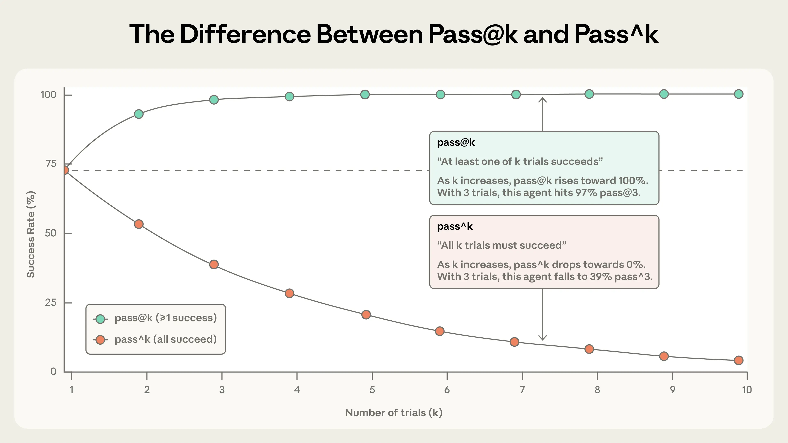

# Chapter 1 Success Criteria for Agents

Whether an Agent performs well should be judged against a set of criteria that are defined in advance and can be inspected afterward.

These criteria must answer three questions. First, what is being measured: which parts of the Agent system are included in this evaluation. Second, what evidence supports the measurement: what evidence can be produced by a single execution. Third, what counts as success: under what conditions is the task considered successfully completed, and whether it must succeed every time. Only after these three questions are answered can the team turn the criteria into evaluation tasks.

This document serves as the direct input to the next step: it determines which evaluation tasks need to be written and what the graders need to check.

## 1.1 What Agent Evaluation Measures

### 1.1.1 Agent Task Execution

One important difference between an Agent and a conventional model call is that its execution process is usually not hard-coded in advance.

In a conventional workflow, developers arrange the steps beforehand—for example, first calling a model to extract information, then querying a database, and finally generating a response. An Agent, by contrast, is given only a task, instructions, and a set of available tools. During execution, it decides for itself what to do next: continue reasoning, call a particular tool, or respond directly to the user[1].

A tool is essentially a function or interface that developers make available to the Agent. For example:

```
check_order_status(order_id)
```

The Agent can pass an order ID to the tool and query the order status from the business system[1].

Some tools are read-only: the business data does not change before and after the call. Other tools actually modify external systems, such as canceling an order, changing an address, or creating a reservation. Whenever the latter type of tool is involved, task success cannot be judged solely by what the Agent says at the end; the evaluator must also inspect what actually changed in the business system.

For example, an Agent replying “Your flight has been booked successfully” does not prove that the task was completed. What really needs to be checked is whether the corresponding reservation record exists in the booking system[2].

Therefore, a single Agent execution usually leaves behind two kinds of information: one is the conversation between the Agent and the user; the other is which tools the Agent called, what arguments it passed, and how those calls ultimately changed the system state[2]. Both kinds of information are part of what an evaluation needs to observe.

Another characteristic of Agents is that there may be multiple correct paths for completing the same task.

For example, in an airline customer-service task, a user wants to change their most recent basic-economy ticket to a flight to San Francisco later that same day. Under the business rules, basic-economy tickets cannot be changed directly. However, if the ticket was purchased less than 24 hours ago, the original booking can first be canceled and then repurchased. The Agent may first check the fare and cabin rules, discover that a direct change is not allowed, and then propose canceling and rebooking[2].

This execution path is not prescribed in advance by the developer. Another Agent might check the cancellation policy first and then look up the booking details. As long as the final actions comply with the rules and fulfill the user’s goal, that path can also be considered successful.

Therefore, Agent evaluation generally does not require reproducing one fixed sequence of steps. What matters more is whether the task was ultimately completed, whether the actions violated any rules, and whether any issues occurred during the process that affected the result.

### 1.1.2 Scope of Agent-System Evaluation

Agent evaluation focuses on **the performance of the entire Agent system on real tasks**.

The model is only one component. Once the system is running, its behavior is jointly affected by the system prompt, tools, skills, memory, state management, runtime framework, and business rules[3][4].

For example, the same model connected to different tools may achieve completely different task-completion rates; omitting a single business rule from the prompt may also cause the Agent to perform an incorrect action. Therefore, knowing how capable the model is in isolation does not directly tell us whether the Agent system can complete business tasks.

This is also what distinguishes Agent evaluation from traditional model benchmarks.

Benchmarks such as MMLU are mainly used to compare the capabilities of models themselves, while metrics such as ROUGE and BERTScore mainly measure certain properties of model outputs. They can indicate roughly how capable a model is, but they do not cover the tools, rules, and runtime environment present in real business systems[8].

Agent evaluation asks more concrete questions, for example:

1. If the user asks to cancel an order, was the order actually canceled successfully?
2. If a refund requires prior user confirmation, did the Agent execute the refund before obtaining confirmation?
3. When calling a tool, did it pass the correct order ID, amount, date, and other arguments?
4. If the user makes three requests at once, did the Agent miss any of them?

These questions directly reflect whether the real system works properly.

Therefore, a useful evaluation must answer at least two things: **whether the Agent can complete the task, and where the problem lies when it fails.**[4]. The second is especially important.

> In a set of retail customer-service tests, researchers manually inspected 115 execution records, 40 of which failed. After excluding four cases where the user instructions themselves contained typos or ambiguity, the remaining failures mainly fell into four categories: the Agent made an incorrect decision, used incorrect information, supplied incorrect tool arguments, or completed only part of a request when the user asked for multiple things at once[2].

Breaking failures down into these categories is not about producing a few impressive percentages. The purpose is to know what should be improved next.

For example, if tool arguments are frequently wrong, the team should further investigate whether the Agent is failing to correctly identify key information such as order IDs, dates, or amounts. If it often misses one item when the user asks for several things at once, the team should check whether the Agent can still remember and track all unfinished tasks in a long conversation.

Both problems ultimately appear as “task failure,” but they require changes in completely different places. Only by breaking failures down can evaluation results truly guide system iteration.

Evaluation also needs to consider the cost of completing tasks.

In the retail customer-service experiment, the Agent side cost about USD 0.38 per task on average, while the simulated-user side cost about USD 0.23; running the entire task suite once cost about USD 200. On the Agent side, 95.9% of the cost came from input prompts, with long system prompts accounting for most of it[2].

Therefore, latency, token consumption, and tool-call cost are also part of an Agent system’s performance. Even if a solution can complete the task, very high execution cost can still make it unsuitable for practical deployment.

## 1.2 Evaluation Evidence

To determine whether an Agent task was successful, there must be evidence that can be inspected.

This evidence mainly comes from two sources:
1. what the test task itself specifies, such as what the user asks for and what result counts as success;
2. what the Agent actually did, such as what it replied, which tools it called, and what state it ultimately left the external system in.

The first part determines “what standard to judge against,” while the second provides evidence of “what actually happened.” The evaluation system compares the two and produces a result.

### 1.2.1 Tasks, Trials, and Evaluation Suites

Evaluation begins by defining specific test tasks.

(1) A task (`Task`) describes something the Agent needs to accomplish in one test. At a minimum, it must specify two things: <u>what input is given to the Agent</u>, and <u>what conditions must be satisfied for the task to count as successful</u>[3].

For example, a customer-service Agent can be given the following task: the user wants to cancel order A and asks for the refund amount. The success criteria defined alongside the task may include: order A is actually canceled, the refund amount is answered correctly, and the entire operation complies with the refund policy. Therefore, when designing an evaluation task, it is not enough to write only a user question. The expected outcome of the task and how that outcome will later be checked must also be defined in advance. Some Agent-evaluation methods organize this similarly to large-model evaluation using three parts: “question, reference result, evaluation criteria”[5]. The exact format is not important; what matters is that every task maps its input to explicit success criteria.


(2) The task itself should also avoid ambiguity as much as possible.

If a user instruction allows two completely different but equally reasonable outcomes, then whichever outcome the Agent reaches is difficult to label simply as right or wrong. When designing tasks, τ-bench repeatedly revises user instructions, lets Agents run them, and then manually inspects the complete execution process until it confirms that, under the specified business rules, the task should lead to a unique outcome[2].

Here, “unique” does not mean that the Agent must follow one unique execution sequence. It means that **the state the task should ultimately reach is unambiguous**. For example, the Agent may query the order, policy, and user information in different orders, but under the business rules it should still cancel the same order and produce the same refund outcome, which makes it possible to judge automatically whether the task was completed.


(3) Running the same task only once is usually not enough.

Models are stochastic to some degree. Even when the input and environment are identical, two executions may use different wording, different tool-call orders, or even different decision paths. Therefore, the same task usually needs to be run multiple times. Each execution is called a trial (`Trial`)[3].

For example, running one task five times produces five trials. The evaluator can then count how many of them succeeded to determine whether the Agent performs consistently on that task.

Different experiments require different numbers of trials. When validating the success rate of an individual task, τ-bench runs each task more than 40 times; for comparisons reported in the main results tables, it runs each task at least three times[2]. The former is mainly used to obtain a more stable estimate of the success behavior of an individual task, while the latter is used to compare the overall performance of different approaches.


(4) Multiple tasks together form an evaluation suite (`Evaluation Suite`).

An evaluation suite is usually designed around a particular capability or business objective. For example, a customer-service Agent evaluation suite may include refund, order-cancellation, and membership-upgrade tasks[3].

For long-term maintenance, tasks can also be divided into sets serving different purposes. For example:

- **Golden set**: stores a group of verified tasks that are reused over time to check basic capabilities;
- **Failure set**: stores tasks on which the Agent has genuinely failed in the past (regression-type tasks), to prevent the same kind of problem from recurring;
- **Challenge set**: contains difficult tasks that the current Agent is still weak at, so the team can observe how far its capabilities can continue to improve[5].

The most important distinction here is between “things the system should already do reliably” and “things the system is still trying to master.” Regression-type tasks usually aim for a pass rate close to 100%, because these capabilities are already considered stable requirements of the system; challenge tasks may deliberately include problems with a relatively low current success rate in order to observe whether the system continues to improve[3].

If the two types of tasks are mixed into a single overall score, the result becomes difficult to interpret. A higher overall pass rate may mean that the Agent genuinely improved on difficult tasks, or simply that more easy tasks were added to the evaluation suite.


Caption: As evaluation expands from single-turn question answering to multi-turn Agent execution, the evaluator must inspect not only model outputs but also the actual changes the Agent makes to the external environment. Image from [3].

### 1.2.2 Execution Records and Final State

A task defines “what should be achieved.” The next step is to record **what the Agent actually did**.


(1) The most direct type of evidence is <u>the record of the entire execution process</u>.

During a task run, the evaluator can record what messages the user sent, what the Agent replied, which tools it called, what arguments it passed, and what results the tools returned. Such a complete execution record is usually called a Trace; some sources also use the terms Transcript or Trajectory[3].

From an implementation perspective, it can be understood as the complete interaction record saved after a task finishes, including model messages, tool calls, and tool outputs[3].

This type of record answers the question, “What happened during the process?”


(2) Another type of evidence is the <u>final state (`Outcome`)</u>, meaning the actual state of the external system after task execution ends.

For example, a booking Agent may finally reply: “Your reservation has been made successfully.” This only proves that the Agent claims to have completed the task. To actually determine whether the booking succeeded, the evaluator still needs to check whether the corresponding reservation record really exists in the booking system or database[3]. That is the evidence provided by the final state.


(3) Why are both types of evidence needed?

Because the final state is good for answering “Was the task ultimately completed?”, while the execution record is good for answering “Why did it succeed or fail?”

For example, suppose a user asks the Agent to correct the wrong address in every order. At the end, the database still contains one order whose address was not updated. The final state alone is already enough to show that the task failed, but it cannot explain why the Agent missed that order.

After inspecting the execution record, the team may discover that the Agent stopped immediately after querying the first order and never checked the remaining ones[2]. Only then can the team further determine whether the problem lies in task planning, information retention, or tool use. One of the main values of recording the execution process is therefore to make failures traceable.

If the logs store only what the user said at the beginning and what the Agent answered at the end, a large amount of intermediate information is lost. An Agent execution may involve understanding the user’s request, choosing the next action, calling a tool, reading the returned result, and then adjusting subsequent actions based on that result. An error at any stage can cause the task to fail[6].

To support diagnosis, the evaluation system should at minimum preserve enough information to reconstruct the key execution process, including what the model actually received and produced, as well as important tool-call records[6].

These records are usually produced by two layers of runtime infrastructure.

- The first layer is the **Agent runtime framework (`Agent Harness`, also called a `Scaffold`)**. It is responsible for actually running the Agent: receiving input, exposing tools to the model, handling tool calls, and returning execution results to the user. During evaluation, the model operates inside this runtime framework, so what is being measured is the result jointly produced by the model and the runtime framework[3].

- The second layer is the **evaluation runtime framework (`Evaluation Harness`)**. It does not perform tasks on behalf of the Agent. Instead, it organizes the overall testing process, such as preparing tasks and environments, running multiple trials in batches, saving execution records, invoking grading logic, and finally aggregating the evaluation results[3].

A simple way to think about it is: **the Agent harness is responsible for “running the task,” while the evaluation harness is responsible for “running the test and recording the results.”**


Caption: An evaluation suite contains multiple tasks, and each task can be run for multiple trials. A trial produces an execution record and a final state, and grading logic determines whether the task succeeded based on this evidence. Image from [3].


### 1.2.3 Run, Trace, and Thread

The previous sections discussed what evidence needs to be saved for a single task. When designing an evaluation in practice, another question must be decided in advance: **how much of the execution process should one test inspect?**

Some problems require checking only one Agent action, some require looking at a complete task turn, and some only become visible across a sequence of multi-turn interactions.


LangChain divides these scopes into three levels: `Run`, `Trace`, and `Thread`[7].


A `Run` is the smallest level and can be understood as one specific model call or tool call.

For example, if it is already known that this step should query an order status, the evaluator can check only:

- whether the Agent selected the correct tool;
- whether it passed the correct order ID;
- whether the result returned by that call matched expectations.

This form of evaluation is well suited to diagnosing very specific problems. It runs quickly, costs little, and when it fails, it is usually easy to identify exactly which step went wrong[7].


A `Trace` is one level higher and represents the complete execution process of an Agent completing one task turn.

For example, suppose the user asks:

> Change the shipping address in my document to the new address.

To determine whether this task turn was completed, the evaluator can check several things at once: whether the Agent modified the correct document, whether the address in the document actually changed, and whether the final response correctly informed the user that the modification had been completed[7].

This level focuses on whether one complete task was correctly completed, while still allowing the tool-call records inside it to be used for process analysis.


A `Thread` is one level higher still and represents an entire conversation consisting of multiple interactions[7].

Some problems do not look obviously wrong when each turn is viewed in isolation, but become apparent when the whole conversation is considered. For example, the user may make a request in the first turn and add new constraints several turns later; or after completing one task, the user may change the objective to a different task. In such cases, the evaluator needs to check whether the Agent can remember important information from earlier turns, correctly handle changes in requirements, and ultimately complete the overall goal. These capabilities cannot be adequately evaluated with single-turn tests alone. An Agent may produce reasonable-looking responses in 90% of individual turns and still fail to complete what the user actually wanted[7]. Therefore, multi-turn Agents also need to be evaluated from the perspective of the whole conversation: what the user ultimately wanted to accomplish, whether the task was actually completed, and at which stage of the conversation the failure occurred.


These three levels answer different questions. `Run` is best suited to locating whether a specific action went wrong; `Trace` is suited to judging whether one complete task turn was completed correctly; and `Thread` is suited to checking task completion across multi-turn conversations. In practice, they are usually combined: larger scopes tell the team **whether the overall task has a problem**, while smaller scopes help the team locate **the specific step where the problem occurred**[7].

> One point requires special attention: the term `Trace` is not used in exactly the same way across all sources. In the Anthropic definition cited earlier, `Trace` refers to the complete execution record left by one trial and is close in meaning to `Transcript` or `Trajectory`[3]. In LangChain’s distinction among `Run / Trace / Thread`, however, `Trace` specifically refers to one Agent execution turn, whose scope may be smaller than the entire multi-turn task[7].


Therefore, when writing evaluation tasks and reporting results, it is not enough to say only “record the Trace” or “aggregate by Trace.” The evaluation must state clearly whether the unit is **one call, one task turn, or an entire multi-turn conversation**. Otherwise, different tests may use different scopes of aggregation, making the final results impossible to compare directly.


## 1.3 Success Criteria

Success criteria answer one fundamental question: **what must an Agent task achieve before it can truly be considered complete?**

These criteria should start from “what the user is actually trying to accomplish” and “what rules the business must comply with,” and then translate them into results, processes, and constraints that can actually be inspected[8].


### 1.3.1 User Goals and Business Goals

When designing success criteria, the first step is to clarify two things: **what the user wants to accomplish, and what business requirements must not be violated.**

> For example, a user may want to cancel an order and receive a refund; that is the user goal. The business system, meanwhile, may require that the refund eligibility criteria be met and that user confirmation be obtained before the refund is executed. These are business rules and risk constraints.

These two categories determine what the Agent should accomplish, but they usually cannot be used directly for scoring. A goal such as “help the user complete the refund smoothly” is too broad for an evaluation system to determine directly whether it is true. **What evaluation actually needs are observable and verifiable facts**, such as:

- whether the correct order was canceled;
- whether the refund amount was correct;
- whether user confirmation was obtained before the refund was executed;
- whether the final order state in the database is correct.

These inspectable facts turn the user goal and business requirements into concrete task-level criteria, and they are what success criteria should actually describe.


At the product level, goals can also be divided into several layers. A business team may care about final outcomes such as activity, retention, and conversion; a search system may further care about recall rate and click-through rate; at the Agent level, the evaluator needs to inspect whether intent was understood correctly, whether the necessary information was retrieved, whether tools were used correctly, and whether the final result is trustworthy[4]. **These layers are related, but they cannot directly substitute for one another.** A decline in a business metric does not directly reveal which Agent decision went wrong; conversely, an improvement in one model capability does not mean a business metric will necessarily improve as well. Therefore, Agent evaluation needs to continue decomposing broad business goals into concrete, inspectable task criteria so that the team can determine at which layer a problem actually occurred[4].


The design sequence should also start from the goal: **first clarify what the user wants to accomplish, then list the business rules and risk constraints that must be followed, and finally translate them into success criteria**. If the order is reversed, teams can easily end up designing tests around metrics they already have, producing a collection of scores that are difficult to relate back to real business value.

**The evaluation tasks themselves should also cover situations real users are likely to encounter.** In addition to the most common normal requests, the suite should include edge cases and inputs that are likely to trigger errors[8]. Only then will the results better reflect how the Agent is likely to perform after deployment, instead of merely showing that it performs well on a set of idealized questions.


### 1.3.2 Success Criteria for a Single Task

For a specific task, completion can be judged from four aspects: **whether the result is correct, whether the operation complies with rules, whether the execution process is reliable, and whether the cost is acceptable.**

(1) The first category is the **task-completion criterion**: whether the intended outcome was actually achieved.

Whenever the external state can be inspected directly, the evaluator should prioritize checking the actual result rather than trusting the Agent’s own description.

> For example, in a return task, the evaluator can check whether the order in the database actually entered the correct return state, while also checking whether the refund amount in the final response is correct[2].

One τ-bench implementation records these two parts separately as the action result and the response result, and then combines them to determine whether the task succeeded. The core idea is simple: the Agent is free to choose its specific execution path, but it must ultimately reach the correct result[2].

Therefore, success criteria usually do not need to specify that the Agent must call one tool first and another tool second. As long as different paths comply with the rules and reach the correct result, they should be allowed.

(2) The second category is **rule-compliance and safety criteria**.

A correct final result does not mean the entire operation was necessarily correct. An Agent may execute a refund without first obtaining user confirmation. The final refund state in the database may be perfectly correct, while the execution process has already violated the business rules[2].

Some constraints can be enforced automatically by tools or business systems. For example, if the Agent passes a nonexistent payment method, the interface can reject the operation directly. In such cases, an incorrect Agent decision may still be blocked by the system.

Other rules must be followed by the Agent itself. For example, free-baggage allowance may depend on both membership tier and cabin class, and the interface may not automatically determine the correct number of bags for the Agent[2]. In such cases, checking only the final database state is insufficient; the execution record must also be inspected to confirm that the Agent made the correct decision under the rules.

The complexity of the rules themselves also affects evaluation results. In τ-bench experiments, removing the business rules from the system prompt reduced `gpt-4o`’s `pass^1` by only 4.4% on relatively simple retail customer-service tasks, but the same change reduced `gpt-4o` by 22.4% on airline tasks where baggage allowance depends on membership tier and cabin class[2]. This shows that different tasks depend on business rules to different degrees. During evaluation, it is better to observe these scenarios separately rather than looking only at one blended overall score.

(3) The third category is **process-quality criteria**.

These criteria focus on whether the Agent omitted any important step during task completion that could affect correctness, safety, or user experience.

> For example, did the Agent collect the information needed to complete the task, use tools to verify key facts, and explain the result to the user after the task was completed[4].

For conversational Agents, the interaction process itself is part of the task. A customer-service task may simultaneously require that the ticket ultimately be resolved, that the entire interaction take no more than 10 dialogue turns, and that the responses satisfy service requirements[3]. These requirements correspond respectively to final state, execution process, and interaction quality, and cannot all be replaced by a single notion of “correct answer.”

However, inspecting the process does not mean prescribing one fixed execution route.

If a test requires the Agent to call tools in one strict predesigned sequence, it can easily misclassify a different but correct execution method as a failure[7]. A more reasonable approach is usually to inspect only those key behaviors that actually affect the result—for example, whether required information was confirmed and whether required actions were executed. The execution order should be constrained explicitly only when the order itself affects correctness or safety.

(4) The fourth category is **efficiency criteria**.

Even when the task can be completed, the evaluator must consider how much time and compute it takes. Common metrics include execution latency, token consumption, number of tool calls, and number of dialogue turns[4].

Efficiency criteria need explicit comparison standards. For example, a task can specify that the Agent may perform at most 30 actions, after which execution is stopped[2]. If the system merely records “how many tokens were used” or “how many tool calls were made” without any threshold or baseline, then it has only collected a statistic and cannot determine whether the result is acceptable.


Putting these four types of criteria together provides a relatively complete description of task quality.

Two Agents may both reach the correct result, but one does so through only a few stable and necessary tool calls, while the other repeatedly retries dozens of times before eventually reaching the same result by chance. From the perspective of the final state, both succeeded; from the perspective of deployment reliability, cost, and user experience, they clearly do not represent the same level of performance[4].

Therefore, a task’s success criteria should cover the aspects that genuinely affect the user outcome. More criteria are not automatically better; checks that add no real judgment value only make the evaluation increasingly complex.

### 1.3.3 Reliability

Even if an Agent succeeds in one test, that single success does not establish that it can complete the task reliably.

Language-model outputs are stochastic. With the input, tools, and environment held constant, repeated executions of the same task may still differ in wording and execution path, and the final result may succeed once and fail the next time[2][3]. Therefore, in addition to judging “did this run succeed?”, some tasks also need to ask: **when the same kind of task occurs repeatedly, can the Agent keep succeeding?**

That is what reliability is intended to measure.

Suppose the same task is run multiple times, with the meaning of the task and the key environmental conditions held constant in every trial. The evaluator can then observe how the Agent performs across those repeated trials. A truly reliable Agent should satisfy the previously defined success criteria in most or even all trials.

Two common metrics are `pass@k` and `pass^k`[2].

- `pass@k` asks: when the same task is run k times, what is the probability that **at least one run succeeds**? For example, a code-generation Agent may try several different solutions; as long as one of them runs successfully, the user may obtain value. This kind of scenario is well suited to `pass@k`.

- `pass^k` asks: when the same task is run k times, what is the probability that **every run succeeds**? Customer service, payments, and order processing are generally closer to this requirement. Users will not consider a system reliable if the same refund request succeeds only “once out of ten attempts,” so these tasks need to focus more on repeated success[3].

As k increases, the two metrics move in opposite directions. `pass@k` increases because more attempts create more chances for at least one success, whereas `pass^k` decreases because it becomes harder for every one of multiple runs to be correct[3].

> For example, if a task has a single-run success rate of 75%, the probability that all three consecutive runs succeed is only: `0.75 × 0.75 × 0.75 ≈ 42%`

This is why an average success rate that looks good can still feel unreliable under repeated real-world use. In τ-bench experiments, function-calling Agents achieved an average task success rate above 60%, but `pass^8` had already fallen below 25%[2].



Caption: The same single-run success rate leads to two different conclusions when viewed across repeated trials. Image from [3].


Therefore, whether reliability needs to be included in the success standard **depends on how users will use the Agent**. If the task allows multiple attempts and only one usable result is needed, `pass@k` may be appropriate. If users expect the same type of request to be handled correctly every time, the reliability requirement should be made explicit—for example, how many times the task should be repeated, how many failures are allowed, and which metric will ultimately be used for judgment.

Reliability metrics themselves also need to be consistent. If the same batch of tests is run at different times, on different machines, or by different people, and no substantive change has occurred, the results should not show large unexplained fluctuations[5]. Otherwise, when the team sees a score change, it will be impossible to tell whether the Agent actually changed or the evaluation method itself is unstable.


## 1.4 Success-Criteria Document

The conclusions above can be consolidated into a one-page document. This page fixes the objects and conditions on which judgments are based, without expanding into the details of individual evaluation tasks. There are two reasons for doing so. First, the criteria need a shared basis so that two domain experts reading the same task can independently reach the same pass/fail conclusion[3]. Second, the criteria need traceable sources, so that every judgment can be traced back to a written requirement.

This page should contain at least five columns.

- The scope of what is being evaluated: among the model, prompts, tools, runtime framework, and environment, which parts are included in this evaluation.
- The user goal and relevant business rules, including domain policies and risk constraints that must be followed.
- The completion, rule-and-safety, process-quality, and efficiency criteria that must be checked for a single task.
- Whether cross-trial reliability needs to be evaluated, and what product-level reliability requirement applies.
- The evidence required for each criterion: final response, execution record, final state, or runtime data.

The dependencies among these columns are one-way. User goals and business rules determine which criteria are retained; the criteria determine what evidence is needed; and the evidence in turn determines what inputs and environment must be prepared for the task. A grader reads only the evidence declared on this page. Evidence that was not declared does not enter the judgment, so the consequence of missing evidence is that the judgment cannot be executed—not that the requirement is relaxed.

A column that cannot be filled in should not be patched with a placeholder conclusion. Missing criteria mean that the task has no usable success standard; missing evidence means that the criterion cannot be checked. Both types of gaps should be exposed before moving on to task design.

The next chapter will turn this page into repeatable evaluation tasks.

## References

1. OpenAI. [Evaluation best practices](https://developers.openai.com/api/docs/guides/evaluation-best-practices?api-mode=responses). `Single-agent architectures`.
2. Sierra. [τ-bench: benchmarking AI agents for the real-world](https://sierra.ai/resources/research/tau-bench) (paper: *τ-bench: A Benchmark for Tool-Agent-User Interaction in Real-World Domains*, arXiv:2406.12045v1). `Abstract`, `1. Introduction`, `3 τ-bench`, `4.2 Key Characteristics`, `5. Experiments`.
3. Anthropic. [Demystifying evals for AI agents](https://www.anthropic.com/engineering/demystifying-evals-for-ai-agents). `The structure of an evaluation`, `Why build evaluations?`, `Evaluating conversational agents`, `How to think about non-determinism in evaluations for agents`, `Step 2: Write unambiguous tasks with reference solutions`, `Design the eval harness and graders`.
4. Meituan. [A Discussion of Agent Evaluation: From Fundamentals to Advanced Practice](https://tech.meituan.com/2026/08/07/Agent-Evaluation.html). `1.1 The Core Purpose of Evaluation`, `1.2 How Agent Evaluation Differs from Traditional Model Evaluation`, `1.3 Why Agent Evaluation Looks Beyond Results to Behavior and Process`, `1.4 Why Observability Is the Foundation of Evaluation`, `2.1 The Core of an Evaluation System Is Building Bridges, Not Stacking Metrics`.
5. Meituan. [Agent Evaluation White Paper Series 01: An Overview of Agent Evaluation](https://tech.meituan.com/2026/09/10/Agent-Evaluation-White-Paper-01.html). `1.1 Back to First Principles`, `1.3 Three Capabilities of an Evaluation System`, `2.1.1 Composition of an Evaluation Set`.
6. Meituan. [Agent Evaluation White Paper Series 01: An Overview of Agent Evaluation](https://tech.meituan.com/2026/09/10/Agent-Evaluation-White-Paper-01.html). `V. Agent Observability Infrastructure: The Foundation of Everything`.
7. LangChain. [Evaluating AI Agents at the Run, Trace, and Thread Level](https://www.langchain.com/resources/agent-evals). `Three levels of agent evaluation`.
8. OpenAI. [Evaluation best practices](https://developers.openai.com/api/docs/guides/evaluation-best-practices?api-mode=responses). `What are evals?`, `How to read evals`.
